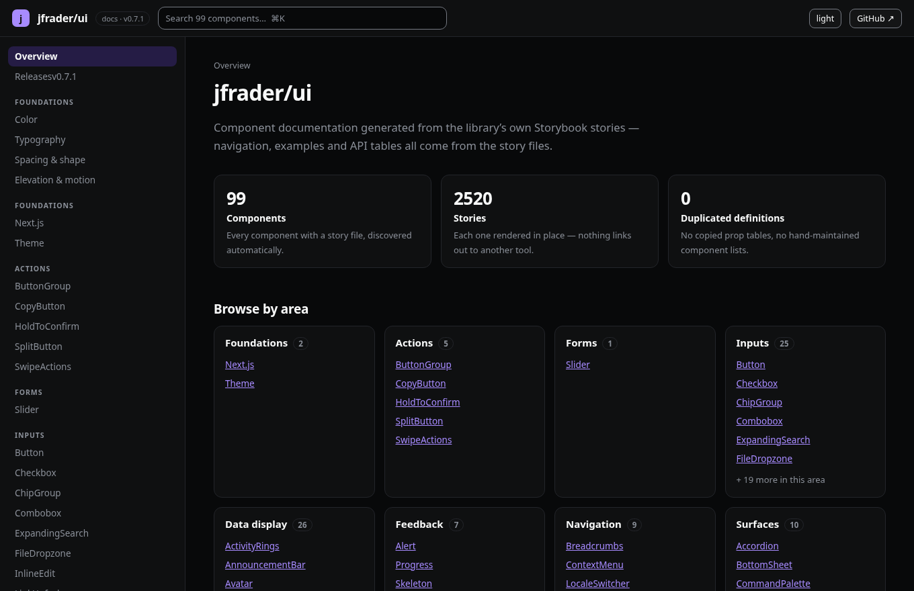
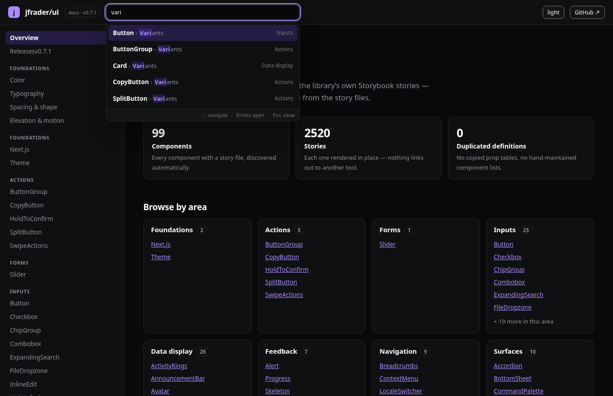
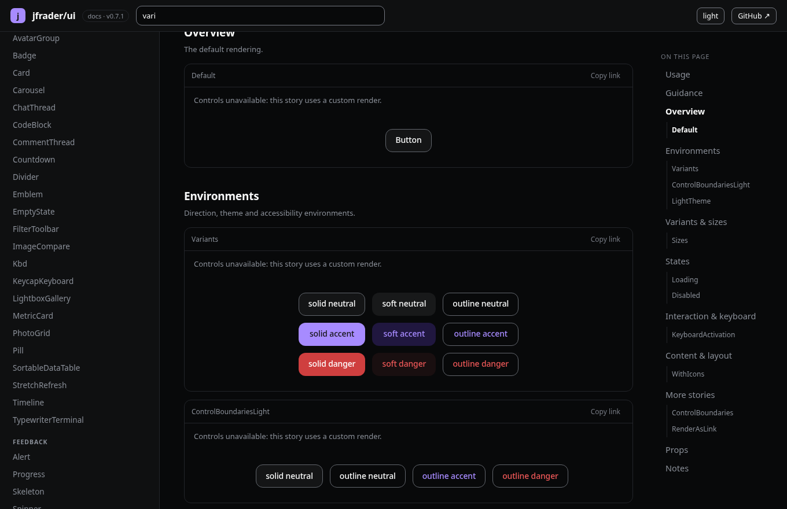
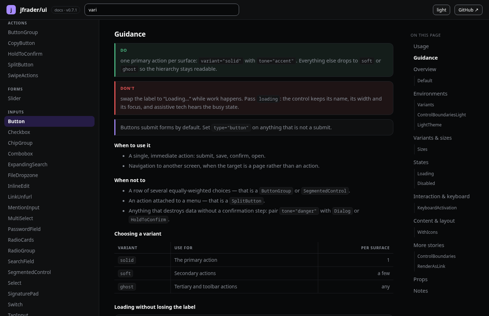
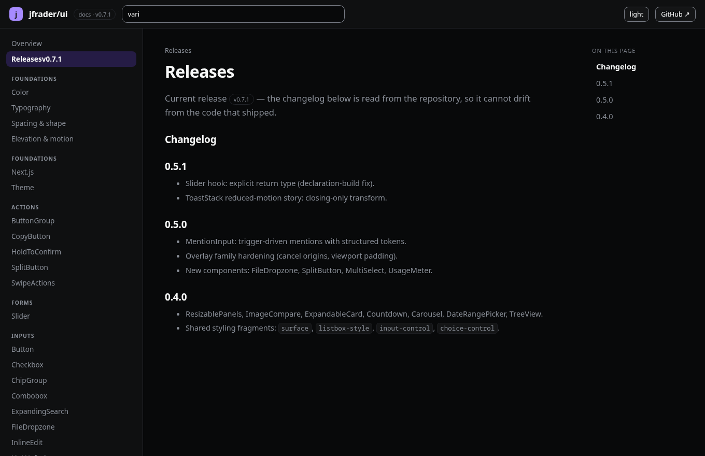
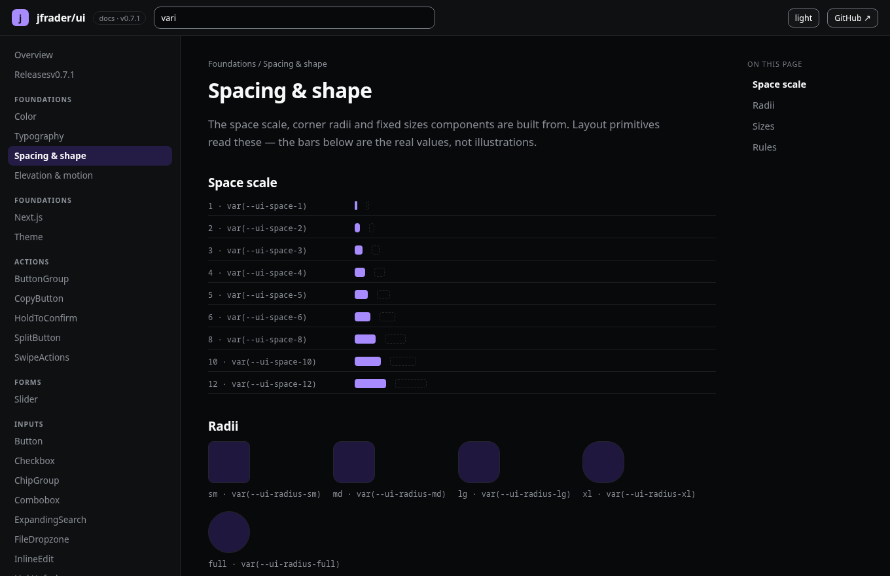

# @jfrader/storybook-docs

A documentation front for **any design system that has Storybook**. Point it at a set of
story files; it generates the navigation, renders every story in place, and builds API
tables from the stories' own `argTypes`. There is no second component list anywhere.

```
example/            # a consumer you can copy
  docs.config.mjs   # ← the only place the design system is described
  vite.config.ts    # registers the plugin
  index.html
  src/main.tsx      # six lines
```

## What it does with your stories

| Piece | Source of truth |
| --- | --- |
| Sidebar, groups, slugs | each story module's `title` (scoped to the `meta` object, so fixtures never leak in) |
| Search (⌘K) | the catalog, scored over component, group and story names |
| Examples (all of them, inline, in sections) | the story module itself — meta `component` + merged `args`, or the story's `render` |
| Sections (Overview / Variants & sizes / States / Interaction & keyboard / Content & layout / Environments / Edge cases) | the story names, bucketed by convention |
| Props tables (one per component and part, with native-element notes) | the component sources — `react-docgen-typescript` for components, the TypeScript compiler API for exported `*Props` types (where compound parts live) |
| Usage snippet | the default story's own arguments |
| Per-example Code disclosures | the story's merged args (hidden when the story uses a custom render, so a snippet never lies) |
| Authored guidance per component | Markdown files in the configured guidance directories, with `> Do —` / `> Don't —` blockquotes rendered as do/don't cards — the part stories cannot generate |
| Foundations: Color, Typography, Spacing & shape, Elevation & motion | your token module (optional) |
| Docs chrome theme | your CSS custom properties (optional) |

Known limits: compound parts declared as property assignments (`Dialog.Content = …`) are picked up
through their exported `*Props` types; parts with no exported props type stay invisible. Stories that
need project-level Storybook decorators fail soft (an error boundary per story frame). Play functions,
controls and a11y checks stay in Storybook — this front is for reading and browsing.

## What it looks like

| | |
| --- | --- |
|  |  |
| The overview: stat tiles, then a card per area with counts and links into every component. | ⌘K search: matches highlighted, story hits listed as `Component › Story`. |
|  |  |
| Every story renders in place, bucketed into sections, with live controls and a Code disclosure per frame. | Authored Markdown becomes typed React blocks: Do/Don't cards, tables, code with language. |
|  |  |
| Releases: the changelog rendered in place, with the current version read from the package. | Foundations: colour, type, spacing/shape and elevation/motion, all from the token module. |

## The reference consumer

`examples/fixtures/` is a second, synthetic design system (Acme UI) used by the scanner tests and by CI
as the build gate that needs no credentials — it proves the engine is not shaped around jfrader/ui.
`examples/jfrader-ui/` is the real one; its `link:` paths resolve against the main clone layout, so a
git worktree copy needs those symlinks repointed locally (see its `node_modules/@jfrader` entries).

## Development

```bash
pnpm install
pnpm test                 # engine unit tests (glob, title extraction, sections, snippets)
pnpm dev                  # the reference consumer in examples/ (port 4310)
```

## Use it

```bash
pnpm install
pnpm --filter <your docs app> dev      # or: vite --config examples/jfrader-ui/vite.config.ts
```

The consumer contract is four files:

```js
// docs.config.mjs
export default {
  site: { title: 'acme/ui', mark: 'a', links: [{ label: 'GitHub', href: '…' }] },
  stories: { from: '@acme/ui', pattern: 'src/components/*/*.stories.tsx' },
  groups: { rename: { Data: 'Data display' }, order: ['Foundations', 'Inputs', 'Components'] },
  theme: {
    attribute: 'data-theme',
    values: ['dark', 'light'],
    vars: { bg: 'var(--acme-bg)', text: 'var(--acme-text)', accent: 'var(--acme-accent)' },
  },
  tokens: { varsModule: '@acme/tokens/vars', varsExport: 'vars', css: ['@acme/tokens/tokens.css'] },
};
```

```ts
// vite.config.ts
import react from '@vitejs/plugin-react';
import { defineConfig } from 'vite';
import { storybookDocs } from '@jfrader/storybook-docs/vite';
import config from './docs.config.mjs';

export default defineConfig({ plugins: [storybookDocs({ config }), react()] });
```

```html
<!-- index.html -->
<div id="root"></div><script type="module" src="/src/main.tsx"></script>
```

```ts
// src/main.tsx
import { start } from '@jfrader/storybook-docs';
start();
```

## Notes and limits

- The plugin scans the resolved package directory and imports story files by absolute
  path, so it works with workspace links and does not require the design system to publish
  its stories or expose extra package exports.
- If the design system is consumed from a published tarball that only ships built files,
  point `stories.from` at a checkout (or publish the story sources) — the tool reads
  source modules by design, because that is what Storybook renders.
- Mounting under a sub-path: set `window.__STORYBOOK_DOCS_BASE__ = '/docs'` before `start()`.
- Not included yet: search, versioned docs, prose authoring, adoption analytics. All of
  them are free/OSS additions once the shape earns them.
